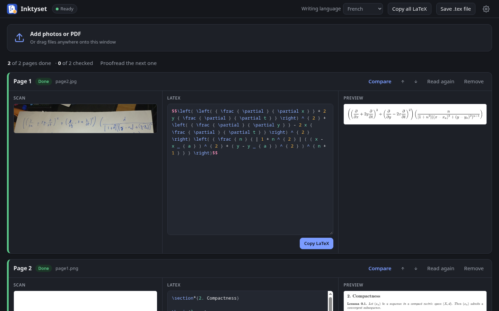
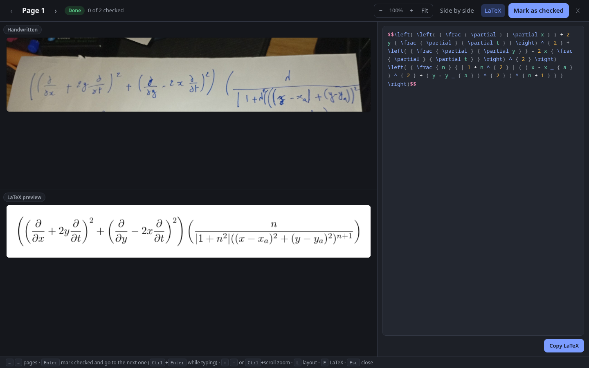

<p align="center"></p>

# Inktyset

**Handwritten pages in, a typeset document you can trust out.** Math first; other handwriting (prose, lecture
notes, lists, tables) works too. Everything runs on your own computer.

Add photos, scans or PDFs of your notes. Inktyset reads each page with a local vision model, compiles it, and
shows the scan next to the LaTeX and the rendered page, so you can proofread page by page, then copy the
LaTeX (or Typst) into your thesis or save one file. Nothing you add leaves your computer.

**[Download](https://sigmasd.github.io/inktyset/)** · Linux, Windows, macOS



## Why not just paste a photo into a chat?

A chat model reads one photo. Inktyset is built for the whole stack of pages:

- **Batch and private:** hundreds of pages read in order, overnight if needed, on your machine.
- **Proven to compile:** every page is compiled and shown rendered, not just text that looks right.
- **Proofreading as a workflow:** the Compare view puts the scan and the rendered page side by side (one
  above the other for a single formula) with linked zoom and scrolling, the editor beside them; `[??]` marks
  what the model couldn't read; a "checked" mark per page tracks your progress.
- **Faithful:** the model is told never to fix your math or complete steps. Chat models happily "correct" it.



## Features

- **Pages in:** drag in photos or PDFs; scan with a scanner (Linux, macOS); or send photos from your phone
  with [Folder Camera](https://github.com/sigmaSd/folder-camera) (optional, off by default).
- **A real LaTeX editor:** highlighting, matching brackets, search, and completion of commands and
  environments (`\fr` → `\frac{}{}`, `\begin{align*}` … `\end{align*}`).
- **Languages:** English by default; French, Arabic (right to left), German, Spanish, Italian, Portuguese,
  Turkish, or any other language for the prose. The math is unaffected and nothing is translated.
  Pages that mix scripts work too, French or English with Arabic words or the other way round: each word
  stays in its own language and direction.
- **Every reading kept:** reading a page again makes a new version; your corrections stay in the old one.
  Compare two versions side by side (both previews, and the words that differ), and keep the one you prefer.
- **Your instructions:** tell the model about your handwriting or notation ("I write ℝ as \\R"), or edit
  all of its instructions. *Try on some pages* reads a few pages again with them, as versions to compare.
- **Any model, on your machines:** the built-in Qwen3.5 9B, any vision model llama.cpp runs (a `.gguf` and
  its `mmproj`), or a model server on your computer or local network (Ollama, LM Studio, llama-server,
  vLLM). Never a cloud service: Inktyset refuses addresses outside your own network.
- **Stop when you like:** Stop on a page (or Stop all) and it waits, unread, until you ask; a page being
  read again goes back to the text it had.
- **Fix a picture:** turn it, straighten it or crop it (Edit picture on the page), from the file as it was
  added, so it can always be changed back. A page already read can be read again with it, as a new version.
- **Ask about a page:** in the Compare view, ask the model about the page (C): what a symbol is, why the
  preview looks wrong, or to write something another way. It sees the scan and the text; pick a part of either
  to point at something, or send the preview. A rewrite is shown against the text, and Apply makes it a new
  version. Chats are kept with the pages; a question goes before the next page is read, or at once with
  *Answer now*. Local like the rest.
- **Your pages where you want them:** in Documents/Inktyset, or any folder you choose in Settings (a private
  one, another drive). Switch between folders whenever you like; each keeps its own pages, and Inktyset keeps
  no list of them. `inktyset --folder=<path>` opens a folder for that run only: a launcher of its own for a
  private folder, say. Add `--class=<name>` and its window gets that launcher's icon in the dock
  (`<name>.desktop`, on Linux).
- **The app in your language:** English, French or Arabic (right to left), following your computer's language
  or chosen in Settings. Other languages are welcome ([translating](docs/translating.md)).
- **LaTeX or Typst:** choose the output in the header. Pages are converted to [Typst](https://typst.app)
  from the model's LaTeX, instantly, and switch back just as fast. The preview uses the LaTeX or Typst
  installed on your computer when it works, otherwise a built-in one
  ([Tectonic](https://tectonic-typesetting.github.io), Typst) downloaded once.
  ([docs/scope.md](docs/scope.md) says what Inktyset is, and isn't, for.)

## Requirements

- About **8 GB of free memory** for the model.
- A **graphics chip** with Vulkan (Linux, Windows) or Apple Silicon (Metal) for speed: a page then takes a
  minute or two. Without one, the processor reads it, much more slowly. Inktyset checks your computer and
  tells you what to expect.
- On first start Inktyset downloads the engine ([llama.cpp](https://github.com/ggml-org/llama.cpp), about
  36 MB) and the model ([Qwen3.5 9B](https://huggingface.co/unsloth/Qwen3.5-9B-GGUF), 6.6 GB). Downloads
  resume after an interruption and are checked before use. Already have the model files? Point Inktyset to
  them.

The installers are not signed: see the [download page](https://sigmasd.github.io/inktyset/) for how to open
an unsigned app on Windows and macOS.

## Development

Electron, TypeScript and [Vite+](https://viteplus.dev) (`vp`), with pnpm.

```sh
vp install          # dependencies
vp hooks enable     # once: format, lint and type-check at each commit
vp run dev          # build and start, printing a link that opens the window in a normal browser
bin/inktyset        # start from this checkout, rebuilding first if the code changed
vp lint             # lint and type-check
vp test             # tests
vp run dist         # installers for this system, into dist/packages/
```

- `src/`: Inktyset itself (pages, queue, model, LaTeX, downloads, phone, scanner, hardware check) and the
  local server the window talks to.
- `shell/electron/`: the Electron shell (window, menus, updates, the hidden window that renders images and
  PDFs).
- `app/ui/`: the window. `tools/`: screenshots. `docs/`: decisions.

`INKTYSET_DATA` and `INKTYSET_USERDATA` move the pages folder and the app's own files, for testing;
`--no-window` starts without opening the window. Releases are built by CI for every `v*` tag.

## Translating

The app and the website speak English, French and Arabic. Adding a language needs no programming: translate
a `.po` file with [Poedit](https://poedit.net) and send it. See [docs/translating.md](docs/translating.md).

## License

GPL-3.0-or-later ([LICENSE](LICENSE)). Inktyset builds on llama.cpp, Qwen, Tectonic, PDF.js, CodeMirror,
Electron and more: see [THIRD_PARTY_NOTICES.md](THIRD_PARTY_NOTICES.md).
